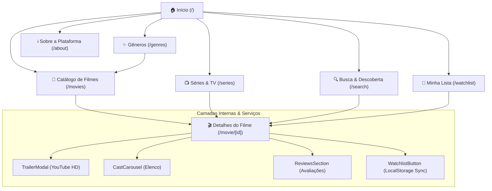

# 🎬 CinePulse • Cinema & Streaming Portal

> Plataforma completa de streaming e catálogo cinematográfico desenvolvida com **Next.js 16**, **React 19**, **Tailwind CSS**, **Framer Motion**, **Lucide React** e arquitetura **SOLID**.

---

## 🗺️ Mapa Completo do Site (Site Roadmap & Navegação)



---

## 📌 Guia Detalhado de Cada Página

### 1. `app/page.tsx` — Página Inicial (Home)
- **Hero Slider em Alta**: Carrossel cinematográfico com pano de fundo em alta definição, reprodução imediata do trailer oficial e adição rápida à lista de favoritos.
- **Barra de Destaques**: Informações de qualidade (Áudio HD, TMDB score, sincronização local).
- **Trilhas Carrossel**:
  - *Em Alta Esta Semana* (`getTrending()`)
  - *Obras-Primas Mais Bem Avaliadas* (`getTopRated()`)
  - *Em Exibição nos Cinemas* (`getNowPlaying()`)
  - *Séries Populares no Streaming* (`getPopularSeries()`)
- **Vitrine de Gêneros**: Acesso direto a 12 gêneros cinematográficos.
- **Call-to-Action (CTA)**: Convite interativo para montar sua biblioteca pessoal.

### 2. `app/movies/page.tsx` — Catálogo Geral de Filmes
- **Filtros Multi-Critério em Tempo Real**:
  - Filtro por pílulas de gênero (Ação, Ficção, Drama, Terror, etc.).
  - Campo de busca textual por título ou sinopse.
  - Ordenação dinâmica por: *Mais Populares*, *Melhor Avaliados*, *Lançamentos Recentes* ou *Ordem Alfabética (A-Z)*.
  - Botão de reset rápido de filtros.
- **Grade Responsiva**: Cards adaptáveis para celulares, tablets e telas 4K com contagem dinâmica de resultados.

### 3. `app/movie/[id]/page.tsx` — Página de Detalhes da Produção
- **Hero de Fundo com Fade Cinematográfico**: Poster em 3D e botão de compartilhamento de link na área de transferência.
- **Metadados Completos**: Nota média e contagem de votos, data de estreia, duração, orçamento e receita mundial.
- **Player Oficial de Trailer**: Modal responsivo com trailer oficial em HD e som original.
- **Carrossel de Elenco (`CastCarousel`)**: Fotos dos atores e atrizes com seus respectivos personagens.
- **Área de Crítica da Comunidade (`ReviewsSection`)**: Comentários de usuários e formulário em tempo real para publicar avaliações com notas de 1 a 5 estrelas.
- **Recomendações Semelhantes**: Lista de filmes correlacionados ao gênero do título atual.

### 4. `app/series/page.tsx` — Séries & Produções de TV
- Seção focada em séries de streaming, temporadas e episódios com notas da crítica internacional.

### 5. `app/genres/page.tsx` — Hub de Exploração por Gênero
- 18 cartões temáticos com ícones animados, descrições contextuais e links diretos que já abrem o catálogo pré-filtrado.

### 6. `app/search/page.tsx` — Pesquisa Instantânea & Descoberta
- Busca com *debounce* de 300ms (não sobrecarrega chamadas de rede).
- Tags de termos populares pré-configuradas (*Duna*, *Oppenheimer*, *Interestelar*).
- Sugestões em alta exibidas automaticamente quando a busca está vazia.

### 7. `app/watchlist/page.tsx` — Gerenciador "Minha Lista"
- **Organização por Abas de Status**:
  - 📋 *Todos*
  - ⏳ *Quero Assistir* (`plan_to_watch`)
  - ▶️ *Assistindo* (`watching`)
  - ✅ *Já Assistidos* (`completed`)
- **Ações Rápidas**:
  - Seletor de status inline em cada card.
  - Remoção com um clique.
  - Botão "Limpar Minha Lista" com diálogo de confirmação.
- **Notificações Toast**: Feedback animado ao adicionar ou remover itens.

### 8. `app/about/page.tsx` — Sobre a Plataforma e Engenharia
- Explicação aprofundada dos pilares SOLID, stack de ferramentas e integração da API.

---

## 🏛️ Engenharia de Software & Princípios SOLID

```
┌─────────────────────────────────────────────────────────────┐
│                 Interface IMovieRepository                  │
│       services/api/movieRepository.interface.ts            │
└──────────────────────────────┬──────────────────────────────┘
                               │
            ┌──────────────────┴──────────────────┐
            ▼                                     ▼
┌─────────────────────────┐           ┌─────────────────────────┐
│       TMDBService       │           │     MockMovieService    │
│  (API TMDB Online v3)   │           │   (Contingência Local)  │
└─────────────────────────┘           └─────────────────────────┘
```

1. **Single Responsibility Principle (SRP)**:
   - `WatchlistStorageService`: Cuida apenas do armazenamento e disparo de eventos.
   - `WatchlistButton`: Gerencia apenas a alternância do botão e feedback sonoro/visual.
   - `TrailerModal`: Isola a injeção do iframe do YouTube e controle de `Esc`.
2. **Open/Closed Principle (OCP)**:
   - Novos provedores de dados (ex: Streaming Provider, Rotten Tomatoes) podem ser integrados criando uma nova classe que implementa `IMovieRepository` sem modificar os componentes de UI.
3. **Liskov Substitution Principle (LSP)**:
   - A camada de dados online e a de contingência respeitam rigorosamente a mesma interface e tipagem.
4. **Interface Segregation Principle (ISP)**:
   - Tipos e interfaces estritas em `types/movie.ts`, garantindo que cada componente só receba o que realmente consome.
5. **Dependency Inversion Principle (DIP)**:
   - A interface do usuário consome `movieService` através do contrato `IMovieRepository`.

---

## 🌐 Conexão com a API Gratuita e Fallback Inteligente

A aplicação possui dupla camada de dados:
1. **API Oficial do The Movie Database (TMDB)**:
   - Para usar sua chave gratuita, crie um arquivo `.env.local` na raiz com:
     ```env
     NEXT_PUBLIC_TMDB_API_KEY=sua_chave_aqui
     ```
2. **Motor de Contingência (Zero Quebra)**:
   - Se nenhuma chave estiver configurada ou se houver falha de rede/rate limit, o sistema ativa automaticamente o banco de dados cinematográfico de `services/api/mockData.ts` contendo pôsteres em alta definição, trailers reais no YouTube, sinopses em português, dados de bilheteria e elenco. O site **nunca quebra**.

---

## 🧪 Testes Automatizados

O projeto inclui suíte de testes unitários nativa cobrindo a persistência da lista de filmes e a lógica de busca/filtro do repositório:

```bash
# Rodar todos os testes
npm test
```

Saída esperada:
```
✔ Movie Repository Logic - filtragem e busca de filmes
✔ Watchlist Storage - adiciona e remove filme com sucesso
✔ Watchlist Storage - atualiza status do filme
ℹ pass 3 | fail 0
```

---

## 🚀 Como Executar o Projeto Localmente

1. **Instalar dependências**:
   ```bash
   npm install
   ```

2. **Iniciar o servidor de desenvolvimento**:
   ```bash
   npm run dev
   ```

3. **Abrir no navegador**:
   Acesse [http://localhost:3000](http://localhost:3000).

---

## 📈 Roadmap de Evolução Futura

- [x] **Fase 1**: Arquitetura base, tipos TypeScript, serviços SOLID e UI Kit.
- [x] **Fase 2**: Integração da API gratuita com fallback inteligente e dados reais.
- [x] **Fase 3**: Páginas completas (Home, Catálogo, Detalhes, Séries, Gêneros, Busca, Watchlist, Sobre).
- [x] **Fase 4**: Suíte de testes automatizados e persistência LocalStorage com CustomEvents.
- [ ] **Fase 5 (Próximos Passos)**:
  - Sistema de autenticação de usuários (OAuth Google / GitHub).
  - Sincronização da Watchlist em banco de dados na nuvem (Supabase / Firebase).
  - Suporte a múltiplos idiomas (i18n Português / Inglês / Espanhol).
  - Filtro por provedores de streaming (Netflix, Prime Video, HBO Max, Disney+).
